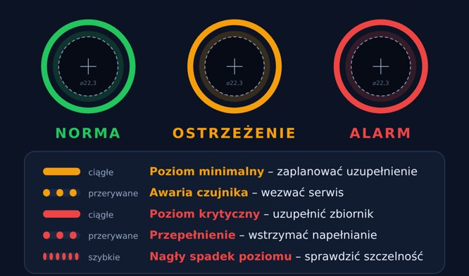
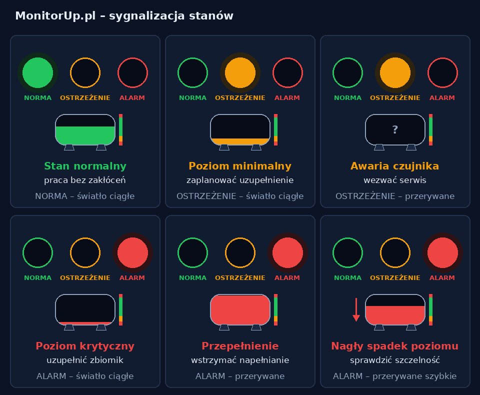

# MonitorUp.pl – Instrukcja obsługi i montażu

**Sterownik monitoringu poziomu cieczy w zbiorniku** · sprzęt HW 1.0 · oprogramowanie SW 0.5.5 (docelowe)

*Wersja robocza 0.2 z 17.11.2026.* Sygnalizacja opisana zgodnie z nakładką panelu przyjętą 16.11.2026 – zostanie wprowadzona w oprogramowaniu 0.5.5. Pozycje oznaczone **[do uzupełnienia]** wymagają danych producenta.

---

## 1. Przeznaczenie

MonitorUp.pl jest sterownikiem do ciągłego pomiaru poziomu cieczy w zbiorniku (olej napędowy, woda, inne ciecze) za pomocą przetwornika hydrostatycznego 4–20 mA. Sterownik:

- mierzy poziom i objętość cieczy,
- sygnalizuje stany alarmowe kontrolkami, sygnałem akustycznym i stykiem usterki,
- wykrywa przepełnienie, poziom minimalny i krytyczny, nagły spadek poziomu (możliwy wyciek lub pobór nieuprawniony) oraz awarię czujnika,
- rejestruje pomiary, zużycie i tankowania na karcie pamięci,
- udostępnia dane systemom nadrzędnym (BMS, SCADA) przez Modbus TCP, MQTT i API.

Typowe zastosowania: zbiorniki paliwa agregatów prądotwórczych, zbiorniki ppoż. wody i paliwa, zbiorniki technologiczne.

## 2. Bezpieczeństwo

- Montaż i podłączenie może wykonywać wyłącznie osoba z odpowiednimi uprawnieniami elektrycznymi.
- Wszystkie podłączenia wykonywać przy odłączonym zasilaniu.
- Sterownik zasilać wyłącznie napięciem stałym 12–24 V DC z zasilacza z separacją galwaniczną.
- W strefach zagrożonych wybuchem (paliwa) stosować przetwornik i bariery zgodne z dokumentacją strefy Ex. Sam sterownik montować poza strefą zagrożenia.
- Urządzenie przeznaczone jest do pracy w sieci lokalnej. Nie udostępniać go bezpośrednio w internecie.
- Sterownik nie zastępuje systemów zabezpieczeń wymaganych przepisami (np. sygnalizacji przecieku lub automatyki pożarowej).

## 3. Panel i sygnalizacja

Panel w drzwiach obudowy zawiera trzy kontrolki stanu, przycisk kasowania alarmu, legendę sygnalizacji i schemat stref zbiornika.

### 3.1 Kontrolki

| Kontrolka | Znaczenie ogólne |
|---|---|
| **NORMA** (zielona) | praca bez zakłóceń, poziom w zakresie normalnym |
| **OSTRZEŻENIE** (pomarańczowa) | stan wymagający zaplanowania działania |
| **ALARM** (czerwona) | stan wymagający natychmiastowego działania |

### 3.2 Stany i zalecane działania

| Kontrolka | Światło | Stan | Zalecane działanie |
|---|---|---|---|
| NORMA | ciągłe | Stan normalny | brak |
| OSTRZEŻENIE | ciągłe | Poziom minimalny | zaplanować uzupełnienie |
| OSTRZEŻENIE | przerywane | Awaria czujnika | wezwać serwis |
| ALARM | ciągłe | Poziom krytyczny | uzupełnić zbiornik |
| ALARM | przerywane | Przepełnienie | wstrzymać napełnianie |
| ALARM | przerywane szybkie | Nagły spadek poziomu | sprawdzić szczelność |

Światło przerywane – ok. 1 błysk na sekundę; przerywane szybkie – ok. 4 błyski na sekundę.

### 3.3 Sygnał akustyczny i kasowanie alarmu

- Sygnalizator akustyczny (buzer) włącza się przy stanach ALARM oraz przy awarii czujnika i pracuje w rytmie migającej kontrolki. Przy poziomie minimalnym sygnalizator nie działa.
- Przycisk **KASOWANIE ALARMU** wycisza sygnalizator i potwierdza alarm. Kontrolka ALARM świeci dalej, dopóki przyczyna nie ustąpi.
- Wystąpienie nowego, poważniejszego stanu ponownie włącza sygnalizator.
- Alarm można też skasować ze strony WWW, przez Modbus, MQTT lub API.
- Tryb kasowania (ręczny lub automatyczny po powrocie poziomu do normy) oraz przypomnienie po zadanym czasie ustawia się w konfiguracji (rozdz. 7.6).

### 3.4 Styk usterki zbiorczej

Wyjście WY5 steruje przekaźnikiem usterki zbiorczej. Przekaźnik jest **zasilony, gdy nie ma usterki** – zanik zasilania sterownika również powoduje sygnał usterki w systemie nadrzędnym. Przyczyny usterki wybiera się w konfiguracji (domyślnie: awaria czujnika, przetwornika A/C, karty pamięci).

### 3.5 Wyświetlacz

Wyświetlacz OLED na płytce pokazuje na przemian:

- **ekran zbiornika** – poziom [cm], wypełnienie [%], objętość [l], stan i słupek z progami,
- **ekran sieci** – adresy Ethernet, Wi-Fi i punktu dostępowego, wersje SW/HW.

## 4. Obsługa codzienna

1. **NORMA świeci** – nie są wymagane żadne czynności.
2. **OSTRZEŻENIE świeci** – zaplanować dostawę cieczy; stan ustąpi samoczynnie po uzupełnieniu.
3. **OSTRZEŻENIE miga** – pomiar jest niewiarygodny; powiadomić serwis. Alarmy poziomu nie działają do czasu usunięcia awarii.
4. **ALARM świeci lub miga** – nacisnąć KASOWANIE ALARMU, aby wyciszyć sygnalizator, i wykonać działanie z tabeli w rozdz. 3.2. Powiadomić osobę odpowiedzialną za obiekt.
5. Bieżący poziom, zużycie i historię można sprawdzić na stronie WWW sterownika (rozdz. 6).

## 5. Montaż i podłączenie

### 5.1 Montaż

- Sterownik montuje się na szynie DIN 35 mm w obudowie elektrycznej, z kontrolkami i przyciskiem w drzwiach (otwory ⌀ 22,3 mm, wg nakładki panelu).
- Wymiary modułu: 122 × 83 × 59 mm.
- Antenę Wi-Fi (jeśli używana) wyprowadzić na zewnątrz metalowej obudowy.

### 5.2 Zaciski

| Zacisk | Funkcja | Uwagi |
|---|---|---|
| Zasilanie + / – | 12–24 V DC | napięcie zasilania = napięcie wyjść |
| A4 | wejście przetwornika 4–20 mA | rezystor pomiarowy 150 Ω |
| OUT1 (WY1) | kontrolka NORMA | wyjście tranzystorowe, napięcie zasilania |
| OUT2 (WY2) | kontrolka OSTRZEŻENIE | j.w. |
| OUT3 (WY3) | kontrolka ALARM | j.w. |
| OUT4 (WY4) | sygnalizator akustyczny | j.w. |
| OUT5 (WY5) | przekaźnik usterki zbiorczej | zasilony = brak usterki |
| DI1 | przycisk KASOWANIE ALARMU | styk bezpotencjałowy, NO |
| RJ45 | Ethernet 10/100 Mb/s | sieć lokalna / BMS |

- Wyjścia OUT pracują napięciem zasilania sterownika. Zalecany prąd ciągły ≤ 2 A na wyjście; większe obciążenia i obwody 230 V podłączać przez przekaźnik pośredniczący.
- Na wejścia DI nie wolno podawać zewnętrznego napięcia.

### 5.3 Przetwornik poziomu

- Przetwornik 2-przewodowy 4–20 mA zasilić z obwodu 12–24 V DC sterownika; przewód sygnałowy podłączyć do zacisku A4. **[do uzupełnienia: schemat podłączenia]**
- Stosować kabel ekranowany; ekran uziemić jednostronnie po stronie sterownika.
- Sondę opuścić na dno zbiornika (lub do znanej wysokości) – wysokość zawieszenia uwzględnia się w kalibracji.
- Prąd poniżej 3,6 mA lub powyżej 21 mA sterownik traktuje jako awarię czujnika.

## 6. Pierwsze uruchomienie

1. Po włączeniu zasilania wyświetlacz pokazuje logo, wersje SW/HW, a sterownik krótko testuje wyjścia (zapalają się kolejno kontrolki).
2. Połączyć się z siecią Wi-Fi sterownika **MonitorUp-XXXX** (hasło fabryczne `monitor123`) i otworzyć `http://192.168.4.1`. Przy podłączonym Ethernecie z DHCP adres sterownika widać na ekranie sieci wyświetlacza.
3. Zalogować się: użytkownik `admin`, hasło `admin`. Sterownik wymusza zmianę hasła przy pierwszym logowaniu.
4. W **Ustawienia → Sieć** ustawić Ethernet lub Wi-Fi (DHCP lub adres stały) oraz tryb punktu dostępowego (zawsze / awaryjnie / wyłączony). Zmiana sieci powoduje restart.
5. W **Ustawienia → Data i czas** sprawdzić datę i godzinę (zegar RTC z podtrzymaniem, synchronizacja NTP).
6. Skonfigurować zbiornik, czujnik i alarmy (rozdz. 7), a następnie wykonać kalibrację.

## 7. Konfiguracja

### 7.1 Zbiornik (Ustawienia → Przetworniki)

- Wysokość zbiornika [cm].
- Objętość (opcjonalnie): walec leżący, walec stojący, prostopadłościan lub tabela przeliczeniowa cm → litry (np. z tabeli legalizacyjnej zbiornika).

### 7.2 Czujnik (Ustawienia → Przetworniki)

- Zakres przetwornika (poziom dla 4 mA i 20 mA) wyrażony jako słup wody.
- Gęstość cieczy: woda 1000 kg/m³, olej napędowy ok. 840 kg/m³ – sterownik przelicza zakres na wysokość cieczy.
- Tabela kalibracji prądu (opcjonalnie, do 24 punktów) – dla instalacji wymagających podwyższonej dokładności.

### 7.3 Kalibracja

1. Zmierzyć rzeczywisty poziom cieczy miarką (prętem) [cm].
2. W **Ustawienia → Przetworniki → Kalibracja** wpisać zmierzoną wartość w polu „Aktualny poziom cieczy” i wybrać **Kalibruj**.

Sterownik koryguje przesunięcie sondy; zakres i gęstość pozostają bez zmian. Kalibracja dwupunktowa (MIN/MAX) jest dostępna w opcjach zaawansowanych. Kalibracja jest zachowywana przy aktualizacji i przywracaniu ustawień fabrycznych.

### 7.4 Progi alarmowe (Ustawienia → Alarmy)

| Tryb | Poziom krytyczny | Poziom minimalny | Przepełnienie |
|---|---|---|---|
| Zbiornik ppoż. wody | ≤ 90 % | ≤ 95 % | ≥ 98 % |
| Zbiornik ppoż. paliwa | ≤ 80 % | ≤ 90 % | ≥ 95 % |
| Własne | wg ustawień | wg ustawień | wg ustawień |

Progi wyrażone są w % wysokości zbiornika (podgląd w cm). Fabrycznie: histereza 2 cm, opóźnienie zadziałania 10 s. **[do potwierdzenia: progi trybów ppoż.]**

### 7.5 Nagły spadek poziomu (Ustawienia → Statystyki)

Alarm zadziała, gdy poziom spadnie o zadaną wartość w zadanym czasie (fabrycznie 3 cm w 10 min). W oknie nocnym (fabrycznie 22:00–6:00) obowiązuje czulszy próg (1 cm). Tankowanie jest rozpoznawane automatycznie i nie powoduje fałszywych alarmów.

### 7.6 Kasowanie i usterka zbiorcza

- **Kasowanie** (Ustawienia → Alarmy → Buzer i kasowanie): ręczne (przycisk, strona, Modbus, MQTT, API; opcjonalne przypomnienie po X min) lub automatyczne – alarm gaśnie po powrocie poziomu do normy.
- **Usterka zbiorcza:** w **Ustawienia → Wyjścia** wybrać przyczyny (awaria czujnika, przetwornika A/C, karty pamięci, brak synchronizacji czasu, brak sieci, brak połączenia MQTT); podgląd stanu na żywo.

### 7.7 Powiadomienia e-mail (Ustawienia → Powiadomienia)

Sterownik może wysyłać wiadomości e-mail o zdarzeniach i raport dzienny. Wymaga połączenia wychodzącego do serwera poczty (internet lub serwer w sieci lokalnej).

1. Wpisać dane serwera SMTP: adres, port, rodzaj szyfrowania (SSL/TLS – port 465, STARTTLS – port 587), login, hasło, adres i nazwę nadawcy.
2. Wpisać do 5 odbiorców i dla każdego zaznaczyć rodzaje powiadomień.
3. Zapisać ustawienia i wysłać wiadomość testową przyciskiem **Wyślij test**. Wynik widoczny jest w polu „Ostatnia wysyłka” i w dzienniku zdarzeń.

| Rodzaj powiadomienia | Kiedy jest wysyłane |
|---|---|
| Poziom krytyczny, przepełnienie, nagły spadek poziomu | wystąpienie stanu ALARM |
| Awaria czujnika, poziom minimalny | wystąpienie stanu OSTRZEŻENIE |
| Powrót do stanu normalnego | ustąpienie alarmu lub ostrzeżenia |
| Skasowanie alarmu | potwierdzenie alarmu przyciskiem, ze strony lub systemu nadrzędnego |
| Usterka zbiorcza | pojawienie się przyczyny usterki (karta SD, sieć, czas, MQTT) |
| Raport dzienny | codziennie o wybranej godzinie: poziom, objętość, zużycie |

Wiadomość zawiera nazwę urządzenia i zbiornika, czas zdarzenia, poziom, objętość, stan oraz zalecane działanie. Ten sam rodzaj zdarzenia jest wysyłany najwyżej raz na ustawiony czas (fabrycznie 15 min). Nieudana wysyłka jest ponawiana przez 24 h. Ustawienia powiadomień może zmienić wyłącznie zalogowany użytkownik.

## 8. Rejestracja danych

- Pomiary zapisywane są na karcie microSD (FAT32) co 5 min i przy każdej zmianie stanu; przechowywanie fabrycznie 10 lat.
- Zakładka **Logi**: wykresy dzień / miesiąc / rok / wszystkie lata, zużycie, tankowania, dziennik zdarzeń.
- **Pobierz pomiary (CSV)** – wszystkie pomiary z wybranego dnia, miesiąca lub roku w jednym pliku (separator `;`, przecinek dziesiętny, kodowanie UTF-8 – plik otwiera się bezpośrednio w programie Excel). Dni, w których sterownik nie rejestrował danych, są oznaczone wierszem „brak danych”. Przygotowanie pliku z całego roku może potrwać do minuty.
- **Pobierz podsumowanie (CSV)** – wartości dobowe (widok miesiąca) lub miesięczne (widok roku): poziom minimalny, średni i maksymalny, zużycie, tankowania.
- Brak lub uszkodzenie karty nie zatrzymuje pomiaru ani alarmów (ostatnie 24 h dostępne w pamięci sterownika).

## 9. Integracja z systemami nadrzędnymi

| Interfejs | Parametry | Uwagi |
|---|---|---|
| Modbus TCP | port 502, Unit ID 1 | fabrycznie wyłączony; zapis fabrycznie wyłączony |
| MQTT | broker w sieci lokalnej | publikacja poziomu, stanu i alarmu co 10 s i przy zmianie; kasowanie alarmu |
| API HTTP | `/api/v1`, tokeny Bearer | uprawnienia, termin ważności i limit zapytań tokenu |

Szczegóły: **Załącznik A** (Modbus TCP), **Załącznik B** (MQTT), **Załącznik C** (API HTTP). Pełną mapę rejestrów w formacie CSV (do importu w systemie SCADA) można pobrać ze strony sterownika: **Ustawienia → Modbus → Pobierz mapę rejestrów**. Transmisja HTTP, Modbus i MQTT nie jest szyfrowana – stosować wyłącznie w wydzielonej sieci lokalnej.

## 10. Konserwacja i serwis

- **Kontrola okresowa** (zalecana co 12 miesięcy): sprawdzenie kalibracji pomiarem miarką, test kontrolek i sygnalizatora, test styku usterki, kontrola karty pamięci.
- **Aktualizacja oprogramowania:** **Ustawienia → System → Aktualizacja**, plik `MonitorUp_vX.Y.Z.bin`. Sterownik przyjmuje wyłącznie pliki podpisane przez producenta; plik niepodpisany lub uszkodzony jest odrzucany, a dotychczasowa wersja pozostaje. Ustawienia i kalibracja są zachowywane.
- **Kopia ustawień:** **Ustawienia → System → Kopia ustawień**; kopia z hasłami jest szyfrowana hasłem kopii.
- **Zapomniane hasło:** przytrzymać przycisk DOWNLOAD na płytce przez 10 s (odliczanie na wyświetlaczu) – przywracane są fabryczne login, hasło i ustawienia sieci; kalibracja pozostaje.
- **Ustawienia fabryczne:** **Ustawienia → System → Restart i ustawienia fabryczne** (kalibracja pozostaje).
- **Zmiana hasła:** **Ustawienia → Konto**.

## 11. Usuwanie usterek

| Objaw | Możliwa przyczyna | Działanie |
|---|---|---|
| OSTRZEŻENIE miga | przerwa lub zwarcie w obwodzie czujnika, uszkodzony przetwornik | sprawdzić przewody i zasilanie przetwornika; wezwać serwis |
| Odczyt poziomu różni się od miarki | przesunięcie sondy, zła gęstość cieczy | sprawdzić gęstość, wykonać kalibrację (rozdz. 7.3) |
| Brak dostępu do strony | zmieniony adres IP, brak sieci | odczytać IP z ekranu sieci; połączyć się przez Wi-Fi sterownika |
| Brak zapisu logów | brak lub uszkodzona karta pamięci | Ustawienia → Logi → Test karty SD; wymienić kartę (FAT32) |
| Fałszywe alarmy nagłego spadku | zbyt czuły próg, pobór technologiczny | zwiększyć próg lub czas w ustawieniach nagłego spadku |
| Styk usterki aktywny | przyczyna z listy usterki zbiorczej | sprawdzić stan na stronie: Ustawienia → Wyjścia |

## 12. Dane techniczne

| Parametr | Wartość |
|---|---|
| Zasilanie | 12–24 V DC |
| Pobór mocy | **[do uzupełnienia]** |
| Wejście pomiarowe | 4–20 mA, 16 bit, rezystor 150 Ω; awaria < 3,6 mA lub > 21 mA |
| Okres pomiaru | próbkowanie 100 ms, wynik co 1 s |
| Wyjścia | 5 × tranzystorowe (MOSFET), napięcie zasilania, ≤ 2 A ciągłego na wyjście |
| Wejście kasowania | styk bezpotencjałowy, izolacja optoelektroniczna |
| Komunikacja | Ethernet 10/100 (RJ45), Wi-Fi 2,4 GHz, Modbus TCP, MQTT, HTTP API |
| Rejestracja | karta microSD (FAT32), do 10 lat pomiarów |
| Zegar | RTC z podtrzymaniem bateryjnym, synchronizacja NTP |
| Wyświetlacz | OLED 128 × 64 |
| Montaż | szyna DIN 35 mm |
| Wymiary modułu | 122 × 83 × 59 mm |
| Temperatura pracy | **[do uzupełnienia]** |
| Stopień ochrony | wg obudowy **[do uzupełnienia]** |

## Załącznik A – Modbus TCP

### A.1 Parametry połączenia

| Parametr | Wartość |
|---|---|
| Port | 502 (Ustawienia → Modbus; fabrycznie wyłączony) |
| Unit ID | 1 (odpowiada również na 0 i 255) |
| Liczba klientów | do 4 jednocześnie |
| Funkcje | 01, 02, 03, 04, 05, 06, 15, 16 |
| Adresowanie | od 0 (adres 0 = 30001 / 40001 w notacji SCADA) |
| Wartości 32-bitowe | dwa rejestry, starsze słowo pierwsze (ABCD) |
| Brak pomiaru | INT16 = −32768 (0x8000), FLOAT32 = NaN |
| Zapis | fabrycznie wyłączony (wyjątek 01); błędna wartość – wyjątek 03; opcjonalna lista dozwolonych adresów IP |

### A.2 Rejestry wejściowe (FC04) – urządzenie

| Adres | Nazwa | Typ / jednostka |
|---|---|---|
| 0 | wersja oprogramowania | UINT16, np. 55 = 0.5.5 |
| 1 | status: b0 karta SD, b1 przetwornik A/C, b2 RTC, b3 czas ustawiony, b4 Ethernet, b5 Wi-Fi, b6 MQTT, b7 alarm, b8 alarm skasowany | bity |
| 2–3 | czas pracy | UINT32, s |
| 4–9 | rok, miesiąc, dzień, godzina, minuta, sekunda | czas lokalny |
| 10 | najgorszy stan | kod stanu (A.5) |
| 11 | stan wyjść OUT1–OUT8 | bity |
| 12 | stan wejść DI1–DI8 | bity |
| 13 | wolne miejsce na karcie SD | MB |
| 14 | temperatura wewnętrzna (RTC) | °C × 10 |

### A.3 Rejestry wejściowe (FC04) – zbiornik (adres bazowy 100)

| Adres | Nazwa | Typ / jednostka |
|---|---|---|
| 100 | poziom | INT16, cm × 10 |
| 101 | wypełnienie | INT16, % × 10 |
| 102 | prąd przetwornika | INT16, mA × 100 |
| 103 | stan zbiornika | UINT16, kod stanu (A.5) |
| 104 | flagi: b0 alarm skasowany, b1 pomiar ważny | bity |
| 105 | trend poziomu | INT16, cm/h × 10 |
| 108–109 | poziom | FLOAT32, cm |
| 110–111 | wypełnienie | FLOAT32, % |
| 112–113 | prąd przetwornika | FLOAT32, mA |
| 114 / 115 | zużycie dziś / wczoraj | INT16, cm × 10 |
| 116 / 117 | średnie zużycie 7 / 30 dni | INT16, cm/dobę × 10 |
| 119 | ostatnie tankowanie | INT16, cm × 10 |
| 120–121 | objętość | UINT32, l (0xFFFFFFFF – objętość nieskonfigurowana) |
| 122–123 | pojemność zbiornika | UINT32, l |
| 124–125 | zużycie dziś | FLOAT32, l |
| 126–127 | średnie zużycie 7 dni | FLOAT32, l/dobę |

### A.4 Wejścia dyskretne (FC02), cewki (FC01/05/15) i rejestry holding (FC03/06/16)

| Typ | Adres | Znaczenie |
|---|---|---|
| wejście dyskretne | 0–7 | wejścia DI1–DI8 |
| wejście dyskretne | 8 / 9 | alarm aktywny / alarm skasowany |
| wejście dyskretne | 10 / 11 / 12 / 13 | poziom krytyczny / minimalny / przepełnienie / awaria czujnika |
| wejście dyskretne | 18 / 19 | karta SD sprawna / czas ustawiony |
| wejście dyskretne | 20 | nagły spadek poziomu |
| cewka | 0–7 | stan wyjść OUT1–OUT8 (tylko odczyt) |
| cewka | 100 | zapis 1 – kasowanie alarmu |
| cewka | 101 | zapis 1 – test wyjść |
| holding | 16 | interwał zapisu pomiarów, min |
| holding | 100 / 101 / 102 | próg krytyczny / minimalny / przepełnienia, cm × 10 |
| holding | 103 / 104 | histereza (cm × 10) / opóźnienie (s) |
| holding | 105 | wysokość zbiornika, cm × 10 |
| holding | 106 / 107 | nagły spadek: wartość (cm × 10) / czas (min) |
| holding | 108 | próg rozpoznania tankowania, cm × 10 |

Zapis progów 100–102 przełącza tryb alarmów na „własne”; wymagana kolejność: krytyczny < minimalny < przepełnienie ≤ wysokość (inaczej wyjątek 03). Kalibracji nie można zmienić przez Modbus.

### A.5 Kody stanu (Modbus, MQTT, API)

| Kod | Nazwa w protokole | Stan na panelu |
|---|---|---|
| 0 | NORMALNY | NORMA – stan normalny |
| 1 | MINIMALNY | OSTRZEŻENIE – poziom minimalny |
| 2 | KRYTYCZNY | ALARM – poziom krytyczny |
| 3 | ZA DUŻY | ALARM – przepełnienie |
| 4 | BŁĄD CZUJNIKA | OSTRZEŻENIE – awaria czujnika |
| 5 | WYŁĄCZONY | zbiornik nieaktywny |
| 6 | NAGŁY SPADEK | ALARM – nagły spadek poziomu |

## Załącznik B – MQTT

Konfiguracja: **Ustawienia → MQTT** (adres brokera, port, użytkownik, hasło, prefiks tematów, interwał). Prefiks fabryczny: `monitorup/monitor`. Wiadomości publikowane są z flagą retain co 10 s oraz natychmiast przy zmianie stanu lub alarmu.

| Temat (po prefiksie) | Kierunek | Treść |
|---|---|---|
| `status` | publikacja | `online` / `offline` (ostatnia wola przy utracie połączenia) |
| `zbiornik1/poziom_cm` | publikacja | poziom, cm (pusty – brak pomiaru) |
| `zbiornik1/procent` | publikacja | wypełnienie, % |
| `zbiornik1/mA` | publikacja | prąd przetwornika, mA |
| `zbiornik1/stan` | publikacja | nazwa stanu wg tabeli A.5, np. `NORMALNY` |
| `zbiornik1/litry` | publikacja | objętość, l (gdy skonfigurowana) |
| `zbiornik1/zuzycie_dzis` | publikacja | zużycie od północy (l lub cm) |
| `zbiornik1/zuzycie_7d` | publikacja | średnie zużycie 7 dni |
| `alarm` | publikacja | JSON: `{"aktywny":true,"skasowany":false}` |
| `alarm_aktywny` | publikacja | `1` / `0` |
| `wyjscia` | publikacja | JSON ze stanem wyjść `out1`…`out8` (0–100) |
| `cmd/kasuj` | subskrypcja | dowolna treść – kasowanie alarmu (gdy polecenia są włączone) |

Przykład: temat `monitorup/monitor/zbiornik1/poziom_cm`, treść `152.4`.

## Załącznik C – API HTTP

### C.1 Dostęp

- Adres: `http://<adres sterownika>/api/v1/…`, odpowiedzi w formacie JSON.
- Uwierzytelnianie tokenem: nagłówek `Authorization: Bearer <token>`. Token tworzy się w **Ustawienia → API → Nowy token**; jest wyświetlany tylko raz.
- Poziomy uprawnień tokenu: **odczyt**, **odczyt + sterowanie**, **konfiguracja**; dla każdego tokenu można ustawić termin ważności.
- Limit: 10 zapytań/s na token; 5 błędnych tokenów z jednego adresu IP blokuje ten adres na 5 min.

Przykład: `curl -H "Authorization: Bearer <token>" http://192.168.0.12/api/v1/status`

### C.2 Najważniejsze zapytania

| Metoda | Adres | Uprawnienie | Opis |
|---|---|---|---|
| GET | `/api/v1/status` | odczyt | poziom, stan, objętość, alarm, wyjścia, sieć, czas |
| GET | `/api/v1/history` | odczyt | ostatnie 24 h, co 5 min |
| GET | `/api/v1/logs/csv?from=RRRR-MM-DD&to=RRRR-MM-DD` | odczyt | pomiary z zakresu dat (do 400 dni) w jednym pliku CSV |
| GET | `/api/v1/stats` | odczyt | zużycie dzienne (do 30 dni) |
| GET | `/api/v1/summary?view=years` | odczyt | podsumowanie lat (także `view=year&y=RRRR`, `view=month&y=RRRR&m=MM`) |
| GET | `/api/v1/events` | odczyt | dziennik zdarzeń |
| GET | `/api/v1/modbus/map.csv` | odczyt | mapa rejestrów Modbus |
| POST | `/api/v1/alarm/ack` | sterowanie | kasowanie alarmu |
| POST | `/api/v1/config` | konfiguracja | zmiana progów, np. `{"tanks":[{"alarmMode":0,"pct":[10,20,95]}]}` |

Kody błędów: 400 błędne dane, 401 brak lub zły token, 403 brak uprawnień, 404 nieznany adres, 429 przekroczony limit zapytań. Kody stanu w polu `state` – tabela A.5.

---

Producent: **[do uzupełnienia]** · www.monitorup.pl
