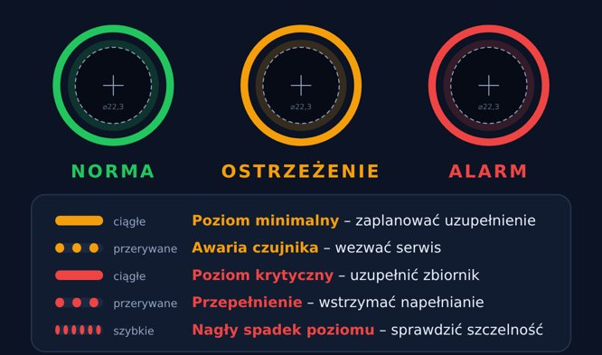

# MonitorUp.pl – karta katalogowa

**Sterownik monitoringu poziomu cieczy w zbiorniku z sygnalizacją alarmową i integracją BMS**

*Wersja robocza 0.1 z 17.11.2026. Pozycje **[do uzupełnienia]** wymagają danych producenta.*

---

## Opis

MonitorUp.pl to sterownik do ciągłego pomiaru poziomu i objętości cieczy w zbiornikach paliwa i wody. Współpracuje z hydrostatycznym przetwornikiem 4–20 mA, sygnalizuje stany alarmowe na panelu obudowy i przekazuje dane do systemów nadrzędnych przez Modbus TCP i API oraz – opcjonalnie – do chmury Zdalio. Pomiary, zużycie i tankowania są rejestrowane lokalnie przez 10 lat.

## Zastosowania

- zbiorniki paliwa agregatów prądotwórczych i kotłowni,
- zbiorniki ppoż. wody i paliwa (gotowe tryby progów alarmowych),
- zbiorniki technologiczne i magazynowe.

## Najważniejsze cechy

- Pomiar poziomu [cm], wypełnienia [%] i objętości [l] – walec leżący, stojący, prostopadłościan lub tabela przeliczeniowa.
- Sygnalizacja 3 kontrolkami (NORMA / OSTRZEŻENIE / ALARM), sygnalizator akustyczny, przycisk kasowania alarmu.
- Alarmy: poziom minimalny, krytyczny, przepełnienie, **nagły spadek poziomu** (wyciek, pobór nieuprawniony) z czulszym progiem nocnym, awaria czujnika.
- Styk usterki zbiorczej w logice bezpiecznej (przekaźnik zasilony = brak usterki).
- Kalibracja jednym pomiarem miarką; korekta gęstości cieczy; opcjonalna tabela kalibracji prądu.
- Automatyczne rozpoznawanie tankowań, zużycie dobowe, miesięczne i roczne.
- Rejestracja na karcie microSD: pomiary co 5 min, dziennik zdarzeń, pliki CSV, wykresy na stronie WWW.
- Integracja z BMS/SCADA: Modbus TCP, HTTP API z tokenami.
- Chmura Zdalio (opcja): szyfrowane połączenie wychodzące, podgląd, kasowanie alarmu, zdalna aktualizacja podpisanego programu; bez zdalnego sterowania wyjściami.
- Bezpieczeństwo: logowanie z blokadą prób, tokeny z uprawnieniami, aktualizacje wyłącznie podpisane cyfrowo przez producenta, szyfrowana kopia ustawień.

## Sygnalizacja

| Kontrolka | Światło | Stan |
|---|---|---|
| NORMA | ciągłe | stan normalny |
| OSTRZEŻENIE | ciągłe | poziom minimalny |
| OSTRZEŻENIE | przerywane | awaria czujnika |
| ALARM | ciągłe | poziom krytyczny |
| ALARM | przerywane | przepełnienie |
| ALARM | przerywane szybkie | nagły spadek poziomu |

## Dane techniczne

| Parametr | Wartość |
|---|---|
| Zasilanie | 12–24 V DC |
| Pobór mocy | **[do uzupełnienia]** |
| Wejście pomiarowe | 1 × 4–20 mA (16 bit), detekcja awarii < 3,6 mA / > 21 mA |
| Wyjścia | 5 × tranzystorowe MOSFET (kontrolki, sygnalizator, usterka zbiorcza), ≤ 2 A na wyjście |
| Wejście | kasowanie alarmu, styk bezpotencjałowy, izolacja optoelektroniczna |
| Komunikacja | Ethernet 10/100 RJ45, Wi-Fi 2,4 GHz (klient i punkt dostępowy) |
| Protokoły | Modbus TCP, HTTP API (JSON), chmura Zdalio (szyfrowana, TLS), NTP, mDNS |
| Rejestracja | microSD (FAT32), do 10 lat pomiarów |
| Zegar | RTC z podtrzymaniem bateryjnym |
| Wyświetlacz | OLED 128 × 64 |
| Montaż | szyna DIN 35 mm; kontrolki i przycisk ⌀ 22 mm w drzwiach obudowy |
| Wymiary modułu | 122 × 83 × 59 mm |
| Temperatura pracy | **[do uzupełnienia]** |
| Stopień ochrony | wg obudowy **[do uzupełnienia]** |
| Oprogramowanie | SW 0.5.x, aktualizacja przez przeglądarkę |

## Wersje i zamawianie

| Kod | Opis |
|---|---|
| **[do uzupełnienia]** | sterownik MonitorUp.pl (moduł DIN) |
| **[do uzupełnienia]** | zestaw w obudowie z kontrolkami, przyciskiem i nakładką panelu |
| **[do uzupełnienia]** | przetwornik hydrostatyczny 4–20 mA (zakres wg wysokości zbiornika) |

---

Producent: **[do uzupełnienia]** · www.monitorup.pl
